# NexPay — Distributed Payment Gateway (Microservices)
NexPay is a Razorpay-inspired distributed payment gateway built using Java 21, Spring Boot, and Spring Cloud Microservices. It provides merchants with authentication, scoped API key management, order creation, and payment processing through a centralized API Gateway, supporting Card, UPI, Net Banking payments.

The platform is designed around reliability, consistency, and secure payment processing. It implements the Strategy Pattern for extensible payment methods, Redis-backed idempotency and rate limiting, PCI-DSS-aligned security controls, and an encrypted card vault using AES-256. Distributed workflows leverage the Saga Pattern, Transactional Outbox, Kafka-based asynchronous processing, and Resilience4j to handle payment state transitions and failures.

NexPay also includes a distributed webhook delivery engine with HMAC-SHA256 signatures, exponential backoff, up to 7 delivery retries, and Dead Letter Queue (DLQ) handling with replay support. Merchant settlements are processed through scheduled jobs, with payment records tracked throughout the settlement lifecycle.

The platform is deployed locally on Kubernetes using Kind, with six Spring Boot microservices and supporting infrastructure including PostgreSQL, Redis, and Kafka. Kubernetes Deployments, StatefulSets, Services, ConfigMaps, and Secrets manage application and infrastructure components, with Docker images built and distributed through Docker Hub.

An integrated observability stack provides application monitoring and distributed tracing through Prometheus, Grafana, and Zipkin. JMeter load testing was also performed to evaluate API performance, throughput, and reliability under concurrent workloads.

<p align="center">
  
  <br>
  <em>Figure 1: High-level payment flow illustrating customer payment initiation through the payment gateway, merchant settlement after commission deduction, and product delivery to the customer.</em>
</p>

## Table of Contents

- [Architecture](#architecture)
  - [Schema](#schema)

- [How It Works](#how-it-works)
  - [Payment Processing — Strategy Pattern](#payment-processing--strategy-pattern)
  - [Card Payment](#card-payment)
  - [UPI Payment](#upi-payment)
  - [Net Banking](#net-banking)
  - [Full Payment Method Flow](#full-payment-method-flow)
  - [Payment Object Lifecycle](#payment-object-lifecycle)

- [Webhooks](#webhooks)
  - [Securing Webhooks](#securing-webhooks)
  - [Retry and Dead Letter Queue](#retry-and-dead-letter-queue)

- [Design Patterns Involved](#design-patterns-involved)
  - [Idempotency Keys Or Idempotent Transactions](#idempotency-keys-or-idempotent-transactions)
  - [Distributed Scheduler Locking](#distributed-scheduler-locking)
  - [Transactional Outbox Pattern](#transactional-outbox-pattern)
  - [Stateless Service](#stateless-service)
  - [Rate Limiting](#rate-limiting)
  - [Circuit Breakers](#circuit-breakers)
  - [Saga Pattern](#saga-pattern)
  - [API Key Rotation](#api-key-rotation)

- [Tech Stack](#tech-stack)

- [Run Locally](#run-locally)
  - [Clone the Repository](#1-clone-the-repository)
  - [Navigate to the Project Directory](#2-navigate-to-the-project-directory)
  - [Start NexPay](#3-start-nexpay)
  - [Access the API Gateway](#4-access-the-api-gateway)
  - [Stop the Project](#5-stop-the-project)
  - [Script Commands](#script-commands)
  - [What the Script Does](#what-the-script-does)
  - [Accessing Other Services](#accessing-other-services)
  - [Service Access URLs](#service-access-urls)
  - [Quick Access to Observability Tools](#quick-access-to-observability-tools)
  - [Deleting the Kubernetes Cluster](#deleting-the-kubernetes-cluster)

- [Load Testing](#load-testing)
  - [Test Scenarios](#test-scenarios)
  - [Test Results](#test-results)
  - [High-Volume Test: API-Level Breakdown](#high-volume-test-api-level-breakdown)
  - [Key Observations](#key-observations)
  - [Tools and Technologies](#tools-and-technologies)
  - [Test Artifacts](#test-artifacts)
  
## Architecture

<p align="center">
  
  <br>
  <em>Figure 2: High-level NexPay microservices architecture illustrating external clients, API Gateway, system and business services, PostgreSQL databases, Redis caching, Kafka event-driven communication, Kubernetes deployment, and the integrated observability stack.</em>
</p>

A distributed, Kubernetes-deployed payment gateway built with **Java 21, Spring Boot 4.1.1, and Spring Cloud Microservices** — supporting merchant onboarding, API key management, order creation, payment processing, card tokenization, refunds, merchant settlements, and webhook delivery.

NexPay is designed around distributed systems patterns used in production payment platforms, including **Saga orchestration, Transactional Outbox, idempotency, distributed locking, event-driven communication, and fault tolerance**.

| **Service** | **Responsibility** |
|---|---|
| `api-gateway` | Centralized API routing, authentication, authorization, rate limiting, and request handling |
| `merchant-service` | Merchant management, authentication, API key generation and rotation, and merchant configuration |
| `payment-service` | Order creation, payment initiation, capture, refunds, payment state management, and payment method strategies |
| `operations-service` | Merchant settlements, webhook delivery, event processing, and operational workflows |
| `vault-service` | Secure card tokenization, encrypted card data storage, and PCI-DSS-aligned security controls |
| `config-service` | Centralized application configuration using Spring Cloud Config with a Git-backed configuration repository |

State is managed through **PostgreSQL** with separate databases for individual services, **Redis** for caching, idempotency, rate limiting, and distributed locking, and **Apache Kafka** for asynchronous event-driven communication.

The platform is deployed locally on a **Kind Kubernetes cluster**, using Docker images and Kubernetes Deployments, StatefulSets, Services, ConfigMaps, and Secrets to manage application and infrastructure components. An integrated observability stack using **Prometheus, Grafana, and Zipkin** provides metrics monitoring, dashboards, and distributed request tracing.

### Schema

<p align="center">
  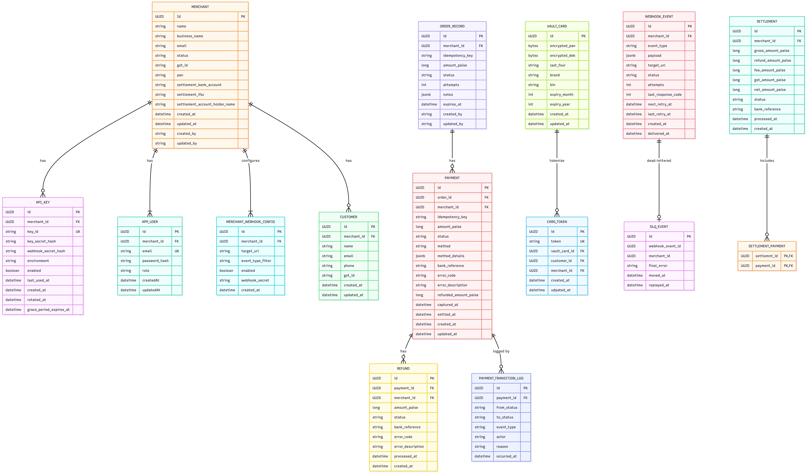
  <br>
  <em>Figure 3: NexPay database entity relationship diagram illustrating merchant management, API keys, customer records, orders, payments, refunds, card tokenization, webhook events, dead letter queue, payment transition logs, and merchant settlement relationships across the platform.</em>
</p>

## How It Works

<p align="center">
  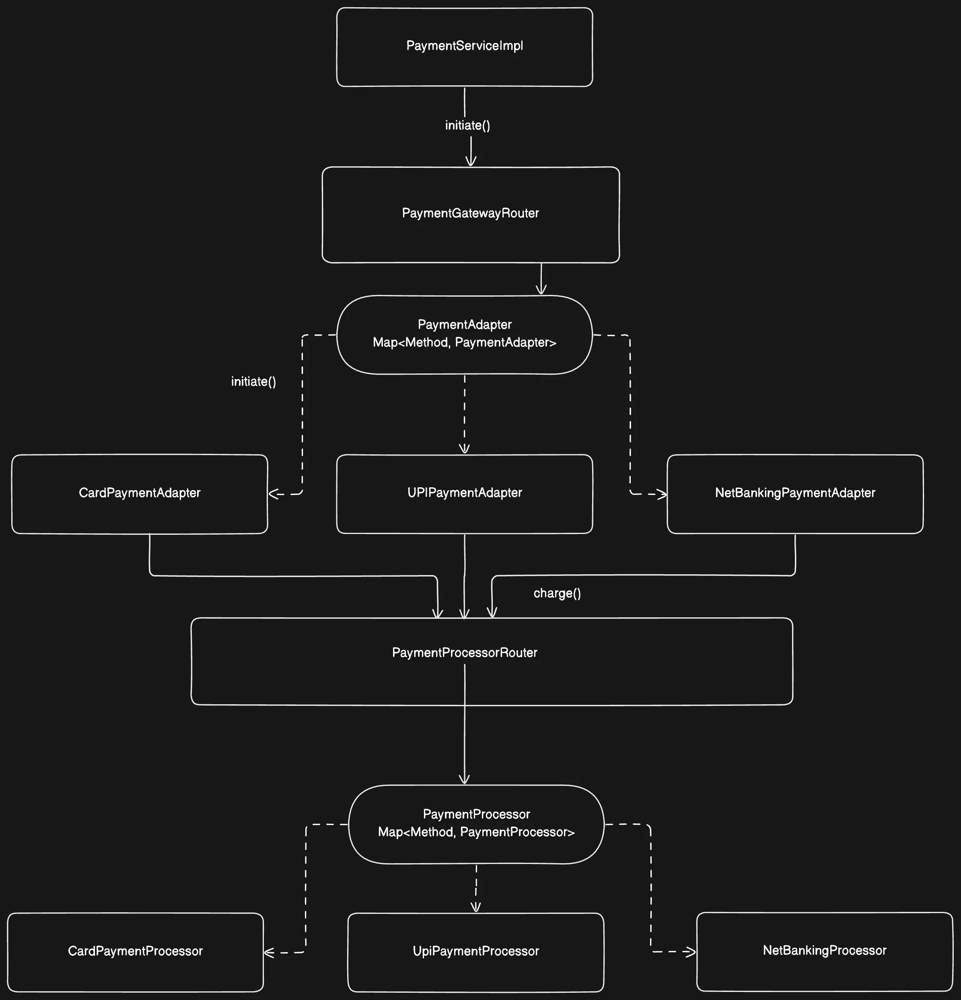
  <br>
  <em>Figure 4: Payment processing architecture illustrating the Strategy Pattern, where PaymentGatewayRouter dynamically selects the appropriate payment adapter (Card, UPI, or Net Banking), which delegates transaction execution to the corresponding payment processor through PaymentProcessorRouter.</em>
</p>

### Payment Processing — Strategy Pattern

NexPay uses the Strategy Design Pattern to support multiple payment methods through a common payment initiation interface. Each payment method has its own implementation, allowing the Payment Service to process different transaction types without tightly coupling the core payment flow to method-specific logic.

- **Payment Strategy**
    - Card Payment Strategy
    - UPI Payment Strategy
    - NetBanking Payment Strategy

The Payment Service selects the appropriate payment strategy based on the requested paymentMethod. Each strategy encapsulates its payment-specific processing logic while following a common contract.

This design makes the payment processing flow extensible: new payment methods can be introduced without fundamentally changing the existing payment initiation workflow.

### Card Payment

<p align="center">
  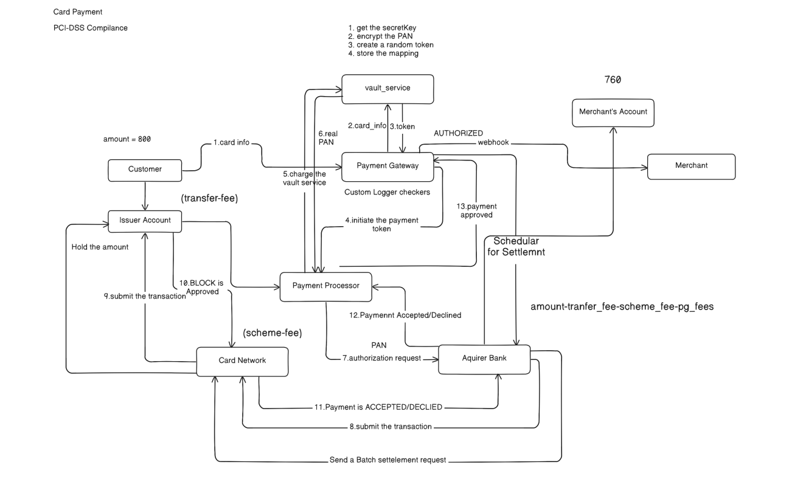
  <br>
  <em>Figure 5: Card payment processing flow illustrating secure card data tokenization through the Vault Service, payment authorization via the card network and acquirer bank, payment status updates, and merchant settlement.</em>
</p>

Card payments involve secure card data handling through the dedicated Vault Service.

1. Customer initiates a card payment.
2. Payment Service selects the Card Payment Strategy.
3. Card details are securely handled through the Vault Service.
4. Vault Service tokenizes and encrypts card data using AES-256-GCM.
5. A card token is returned and used to reference the stored card details.
6. Payment processing continues through the card payment processor.
7. The payment result is received and the payment status is updated.
8. On successful authorization and capture, the payment moves through the settlement lifecycle.

> PCI-DSS Compliance: All cardholder data processing occurs within the vault service boundary. No PAN is persisted outside the encrypted vault store.

### UPI Payment

<p align="center">
  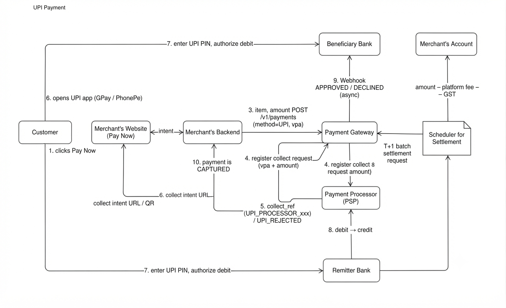
  <br>
  <em>Figure 6: UPI payment flow illustrating payment initiation, collect request registration, QR code or intent generation, customer authorization through a UPI application, bank-side debit and credit processing, asynchronous payment confirmation, and merchant settlement.</em>
</p>

UPI payments are handled through a dedicated UPI payment strategy.

1. Customer initiates UPI payment.
2. UpiPaymentProcessor generates a collect reference.
3. Customer receives a QR code or intent URL.
4. Customer authorizes via UPI app (Google Pay, PhonePe, etc.) with UPI PIN.
5. Remitter bank routes through UPI rail to beneficiary bank.
6. Async webhook confirms approval or decline.
7. T+1 settlement credits merchant account minus fees.

### Net Banking

<p align="center">
  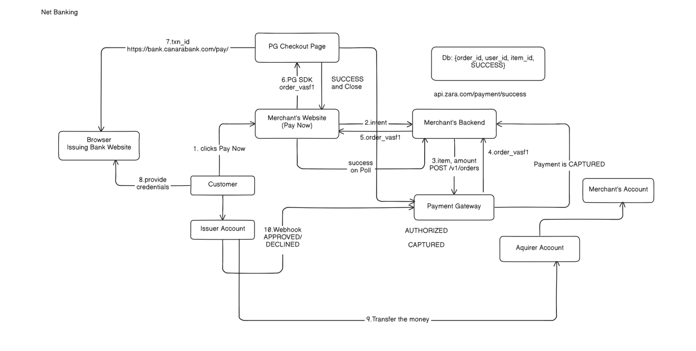
  <br>
  <em>Figure 7: Net Banking payment flow illustrating customer bank selection, redirection to the bank checkout page, customer authentication, payment authorization, asynchronous status notification, and merchant payment capture.</em>
</p>

Net Banking payments are handled independently through their own payment strategy.

1. Customer selects NetBanking and chooses their bank.
2. Gateway redirects to bank's checkout page.
3. Customer authenticates with bank credentials.
4. Bank processes the transfer to the acquirer account.
5. Bank sends async webhook to gateway confirming the payment.
6. Merchant account is updated.
---
> Design Benefit: The Strategy Pattern separates payment method selection from payment execution. This improves extensibility, maintainability, and testability while keeping the core payment initiation flow independent of individual payment methods.

### Full Payment Method Flow

<p align="center">
  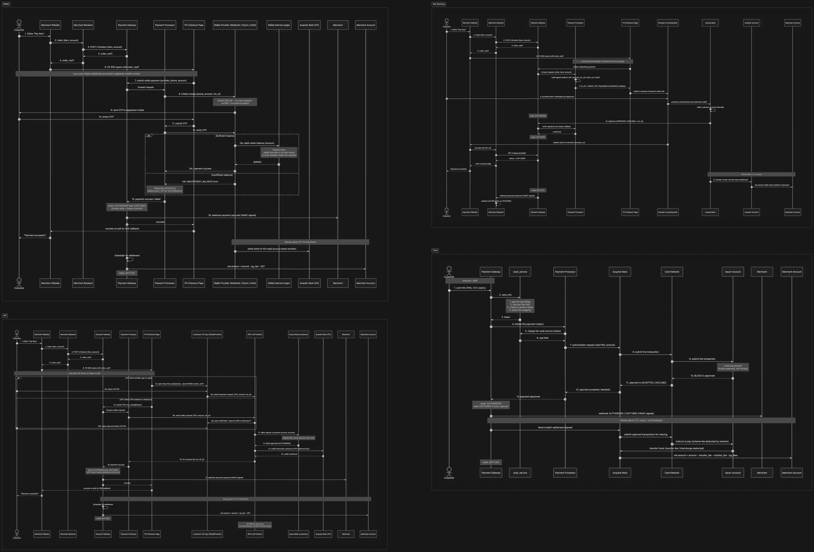
  <br>
  <em>Figure 8: End-to-end payment sequence diagrams illustrating interactions between customers, merchant applications, API Gateway, Payment Service, payment processors, Vault Service, banking systems, and settlement components across different payment methods, including Card, UPI, Net Banking, and Wallet.</em>
</p>

### Payment Object Lifecycle

<p align="center">
  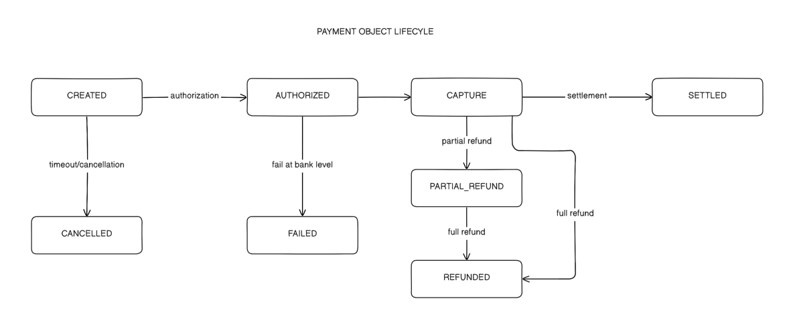
  <br>
  <em>Figure 9: NexPay payment object lifecycle illustrating state transitions from CREATED to AUTHORIZED, CAPTURE, and SETTLED, along with cancellation, failure, partial refund, and full refund paths.</em>
</p>

Every payment in NexPay follows a strict state machine that governs its lifecycle. Only explicitly defined state transitions are permitted. Invalid transitions throw `InvalidStateTransitionException` instead of silently corrupting payment state.

| **State** | **Meaning** | **Transitions To** |
|---|---|---|
| `CREATED` | Payment record created; no bank call made yet. | `AUTHORIZING`, `CANCELLED` |
| `AUTHORIZING` | Collect request sent; awaiting asynchronous bank response. | `AUTHORIZED`, `FAILED`, `CANCELLED` |
| `AUTHORIZED` | Bank approved; funds reserved but not yet captured. | `CAPTURING`, `AUTH_EXPIRED` |
| `CAPTURING` | Capture request in flight. | `CAPTURED`, `AUTHORIZED` (if capture fails) |
| `CAPTURED` | Funds captured; eligible for settlement or refund. | `SETTLED`, `PARTIALLY_REFUNDED`, `REFUNDED` |
| `PARTIALLY_REFUNDED` | Part of the captured amount returned to the customer. | `REFUNDED` |
| `REFUNDED` | Payment fully refunded. | Terminal |
| `SETTLED` | Included in a merchant settlement batch. | `PARTIALLY_REFUNDED` |
| `AUTH_EXPIRED` | Authorization window elapsed before capture. | Terminal |
| `CANCELLED` | Order or payment cancelled. | Terminal |
| `FAILED` | Terminal failure, typically due to a bank decline. | Terminal |

<p align="center">
  
  <br>
  <em>Figure 10: NexPay payment state machine illustrating the transition from CREATED to AUTHORIZING, AUTHORIZED, CAPTURING, and CAPTURED, with authorization failure handling through the FAILED state. Each transition is triggered by a defined payment event.</em>
</p>

- **Terminal States**
  The following payment states represent terminal outcomes:

  - **`FAILED`** — Bank decline or processing error.
  - **`CANCELLED`** — User or system cancellation.
  - **`REFUNDED`** — Full refund completed.
  - **`AUTH_EXPIRED`** — Authorization window elapsed before capture.

## Webhooks

### Securing Webhooks

<p align="center">
  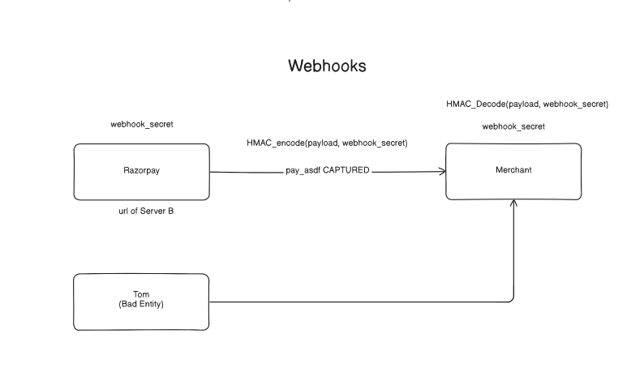
  <br>
  <em>Figure 11: NexPay webhook security flow illustrating HMAC-based payload signing and signature verification using a shared webhook secret, ensuring webhook authenticity and protecting merchant endpoints against unauthorized or tampered requests.</em>
</p>

NexPay secures webhook notifications using **HMAC-SHA256** to ensure message authenticity and integrity.

When a payment event occurs (e.g., `payment.captured`), NexPay generates a signature using `signerUtil.sign(signatureJson, target.webhookSecret())`, where the merchant-specific webhook secret is used as the HMAC key.

The generated signature is stored alongside the `WebhookEvent` record, which is persisted with a `PENDING` status and scheduled for delivery through the retry queue.

During delivery, NexPay sends an HTTP POST request to the merchant's configured webhook URL, including the generated signature in the `X-PayGrid-Signature` header. The request contains the event type and associated payload.

On successful delivery, the webhook event is marked as `DELIVERED` and its delivery timestamp is recorded. Failed requests are handled by the retry mechanism.

- **Webhook Security**

  - **HMAC-SHA256:** Generates a merchant-specific signature for each webhook payload.
  - **Encrypted Secret Storage:** Merchant webhook secrets are encrypted at rest rather than stored in plaintext.
  - **Signature Header:** Transmits the generated signature through `X-PayGrid-Signature`.
  - **Retry Handling:** Failed webhook deliveries are handled through the retry queue, with support for up to **7 delivery attempts**.
  - **Dead Letter Queue (DLQ):** Failed events can be retained for investigation and replay.

Merchants can independently verify webhook authenticity by recomputing the HMAC-SHA256 signature using their shared webhook secret and comparing it against the received signature using a **constant-time comparison**.

### Retry and Dead Letter Queue

<p align="center">
  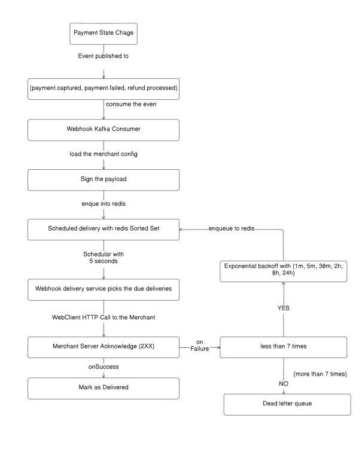
  <br>
  <em>Figure 12: Webhook delivery and retry workflow illustrating Kafka-based event consumption, merchant configuration loading, HMAC payload signing, Redis Sorted Set scheduling, HTTP delivery, exponential backoff retries, and Dead Letter Queue (DLQ) handling.</em>
</p>

The webhook delivery and retry pipeline begins when a payment state change event, such as `payment.captured`, `payment.failed`, or `refund.processed`, is published and consumed by the **Webhook Kafka Consumer**.

The consumer loads the merchant configuration, signs the payload, and enqueues the webhook event into a **Redis Sorted Set** for scheduled delivery.

A dedicated webhook delivery service picks up due events and makes an HTTP POST request to the merchant's configured server URL.

- **Successful Delivery:** A `2XX` response marks the webhook event as `DELIVERED`.
- **Failed Delivery:** If delivery fails and the attempt count is below seven, the event is scheduled for retry using a predefined exponential backoff schedule and re-enqueued into Redis.
- **Dead Letter Queue (DLQ):** Once all seven delivery attempts are exhausted, the event is moved to the DLQ for manual inspection and replay instead of being retried indefinitely.

| **Attempt** | **Backoff Duration** |
|:-----------:|:--------------------:|
| 1 | Immediate |
| 2 | 1 minute |
| 3 | 5 minutes |
| 4 | 30 minutes |
| 5 | 2 hours |
| 6 | 8 hours |
| 7 | 24 hours |
| **Failed** | **Moved to DLQ for manual inspection and replay** |

- **Event Scheduling:** Redis Sorted Set manages webhook delivery schedules based on execution timestamps.
- **Scheduled Processing:** The delivery service periodically checks Redis for due webhook events.
- **Exponential Backoff:** Failed deliveries are retried using increasing intervals to avoid repeatedly overwhelming merchant servers.
- **Failure Isolation:** Exhausted events are moved to the Dead Letter Queue (DLQ), allowing investigation and manual replay without blocking other webhook deliveries.

## Design Patterns Involved
The payment gateway implements several distributed systems patterns to ensure reliability, consistency, fault tolerance, and horizontal scalability.

| **Pattern** | **Implementation / Where** | **Why It Matters at Scale** |
|---|---|---|
| **Idempotency Keys** | `X-Idempotency-Key` header, Redis-backed `IdempotencyFilter` | Retries are inevitable at scale due to timeouts, load balancer failovers, and network failures. Without idempotency, retries can create duplicate orders and charges. |
| **Distributed Scheduler Locking** | `ShedLock` on `OutboxPoller`, `BankCallbackSimulator` | When multiple service replicas run scheduled jobs, every replica could process the same task. Distributed locking ensures only one instance executes a scheduled job at a time. |
| **Transactional Outbox** | Outbox table + poller, atomic with the business database write | Database writes and Kafka publishing cannot be guaranteed as one atomic operation. The transactional outbox prevents lost events during partial failures. |
| **Stateless Services** | All services — state persisted in databases and Redis, never in application memory | Stateless services enable horizontal scaling because any replica can handle any incoming request without depending on another pod's local state. |
| **Rate Limiting** | Redis-backed, per-API-key rate limiting (Token Bucket, Sliding Window, and Fixed Window) | Prevents a single misbehaving client from exhausting system resources and impacting other merchants. |
| **Circuit Breaker + Retry** | Resilience4j around `payment-service` and `merchant-service` Feign clients | Prevents cascading failures by temporarily stopping requests to unhealthy dependencies while allowing controlled retries and recovery. |
| **Saga Pattern (Orchestration + Choreography)** | `saga/PaymentAuthorizationRecorder`, `PaymentServiceImpl`, `SettlementTransactionExecutor`, `WebhookKafkaConsumer` | Payments span multiple services, databases, external gateways, and webhook delivery. Saga workflows and compensating actions help maintain business consistency when distributed transactions fail. |
| **Full Observability** | Prometheus, Grafana (per-service CPU and memory metrics), Zipkin distributed tracing | Enables monitoring, bottleneck identification, capacity planning, and debugging across distributed services. |
| **API Key Rotation** | Merchant API key rotation mechanism | Allows merchants to replace compromised API keys without permanently disrupting integrations, reducing the impact of credential exposure. |

### Idempotency Keys Or Idempotent Transactions

<p align="center">
  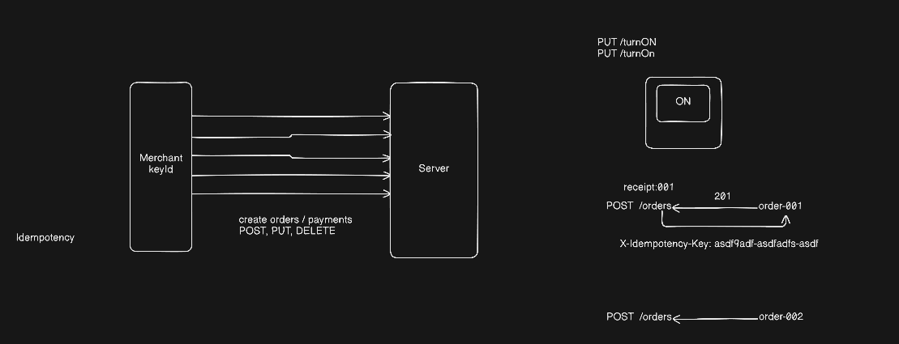
  <br>
  <em>Figure 13: Redis-backed idempotency workflow demonstrating how NexPay handles repeated API requests using the X-Idempotency-Key header to prevent duplicate order and payment processing.</em>
</p>

NexPay implements **Redis-backed idempotency** at the API Gateway to prevent duplicate order and payment processing when clients retry API requests.

Clients provide an `X-Idempotency-Key` header with requests that require idempotent processing. The API Gateway uses the shared idempotency implementation from the `common-lib` module to check Redis before forwarding the request to downstream services.

- **New Request:** If the idempotency key has not been processed, the request proceeds to the respective microservice.
- **Completed Request:** If the key has already been processed, the previously stored response is returned without executing the operation again.
- **In-Progress Request:** Duplicate requests for an operation that is still being processed are identified and handled without initiating another execution.

Redis maintains the idempotency state and previously processed results, allowing NexPay to handle client retries consistently and reduce the risk of duplicate order creation or payment processing.

### Distributed Scheduler Locking

<p align="center">
  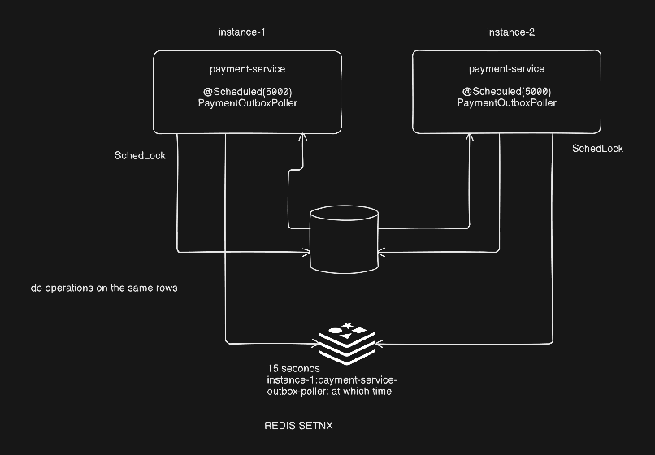
  <br>
  <em>Figure 14: Distributed scheduler coordination illustrating how multiple payment-service instances coordinate scheduled outbox polling using ShedLock and Redis SETNX to avoid concurrent processing of the same events.</em>
</p>

NexPay uses **ShedLock and Redis SETNX** to coordinate scheduled outbox polling across multiple payment-service instances and prevent concurrent execution of scheduled tasks.

Each payment-service instance runs the `PaymentOutboxPoller` through Spring's `@Scheduled` annotation at a 5-second interval.

- **ShedLock:** Coordinates scheduled execution across multiple instances using a shared locking mechanism, ensuring that only one instance executes the scheduled task at a time.
- **Redis SETNX:** Provides atomic lock acquisition using the set-if-absent operation, preventing multiple instances from acquiring the same distributed lock simultaneously.
- **Outbox Polling:** The instance that successfully acquires the lock proceeds with polling and processing pending outbox events.
- **Lock Expiration:** Redis locks use a 15-second validity period, allowing other instances to acquire the lock after expiration.

This coordination mechanism helps prevent duplicate processing of outbox events when multiple payment-service replicas are running.

### Transactional Outbox Pattern

<p align="center">
  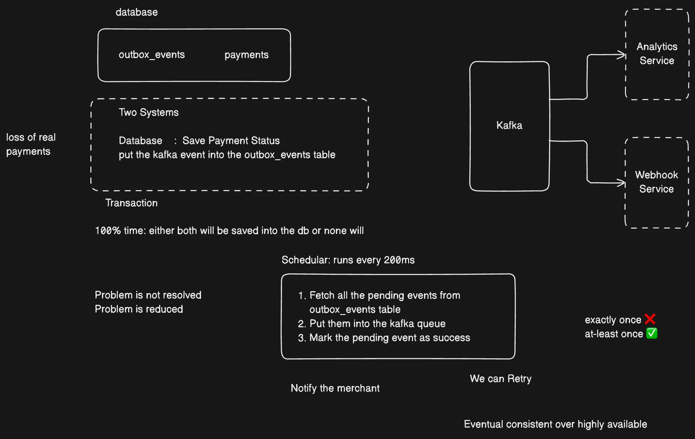
  <br>
  <em>Figure 15: Transactional Outbox pattern illustrating atomic persistence of payment updates and corresponding outbox events, followed by scheduled Kafka publishing and asynchronous event consumption by downstream services.</em>
</p>

NexPay implements the **Transactional Outbox Pattern** to ensure reliable event publishing between PostgreSQL and Kafka without relying on a distributed transaction across both systems.

The challenge is that updating a payment in PostgreSQL and publishing its corresponding event to Kafka are two independent operations. If the application crashes between these operations, the payment update could be committed while the Kafka event is lost.

#### Implementation Flow

1. **Atomic Database Transaction:** When a payment state changes, NexPay updates the payment record and inserts the corresponding event into the `outbox_events` table within the same database transaction. Both operations succeed or roll back together.

2. **Scheduled Outbox Polling:** The `PaymentOutboxPoller` periodically checks the database for pending outbox events using Spring's `@Scheduled` mechanism.

3. **Distributed Coordination:** ShedLock and Redis-backed distributed locking coordinate scheduled execution across multiple payment-service instances, preventing concurrent polling of the same scheduled task.

4. **Kafka Publishing:** The poller retrieves pending events and publishes them to the appropriate Kafka topic for asynchronous processing by downstream consumers.

5. **Event Status Update:** After successful Kafka publishing, the corresponding outbox event is marked as processed in the database.

6. **Retry Handling:** If publishing fails, the event remains eligible for retry rather than being silently discarded.

#### Delivery Guarantee

The Transactional Outbox Pattern provides **at-least-once event delivery**, not exactly-once delivery.

A failure can occur after Kafka accepts an event but before the database records it as successfully published. In that case, the poller may publish the same event again during a subsequent execution.

Therefore, downstream consumers should handle duplicate events idempotently.

#### Key Benefits

- **Atomic Persistence:** Payment updates and outbox event creation are committed within the same database transaction.
- **Reliable Publishing:** Events remain persisted until they are successfully published to Kafka.
- **Asynchronous Communication:** Kafka decouples payment processing from downstream event consumers.
- **Fault Tolerance:** Pending events can be retried after temporary publishing failures.
- **Multi-Instance Coordination:** Distributed locking prevents multiple application instances from executing the same scheduled polling task concurrently.

### Stateless Service

<p align="center">
  
  <br>
  <em>Figure 16: Stateless API Gateway authentication flow illustrating JWT and API key validation, merchant identification, rate limiting, and propagation of merchant context to downstream microservices through request headers.</em>
</p>

NexPay follows a stateless request-handling approach where the API Gateway authenticates incoming requests using JWT or API key credentials, extracts the associated merchant ID and API key ID, and propagates this context to downstream microservices through HTTP headers such as X-Merchant-Id and the API key ID header. Services like payment-service consume these headers to identify the merchant and process merchant-specific operations without maintaining session state in local memory. This enables horizontal scalability, centralized authentication, and consistent merchant context propagation across service instances.

### Rate Limiting

<p align="center">
  
  <br>
  <em>Figure 17: Redis-backed rate-limiting workflow illustrating how the API Gateway enforces per-API-key request limits and rejects requests exceeding the configured threshold with HTTP 429 (Too Many Requests).</em>
</p>

The `common-lib` module provides four Redis-backed rate-limiting algorithms, enforced independently for each API key.

| **Algorithm** | **Implementation Class** | **Use Case** |
|---|---|---|
| Token Bucket | `TokenBucketRateLimiter` | Allows controlled bursts of requests with a steady token refill rate. |
| Sliding Window | `SlidingWindowRateLimiter` | Enforces request limits over a precise rolling time window. |
| Sliding Window (Lua) | `SlidingWindowLuaLimiter` | Uses an atomic Redis Lua script for distributed rate-limit enforcement. |
| Fixed Window | `FixedWindowRateLimiter` | Maintains a request counter that resets at each window boundary. |

> **Currently Used:** NexPay uses the **Fixed Window** algorithm for simplicity. Requests exceeding the configured per-API-key limit are rejected with HTTP `429 Too Many Requests`.

### Circuit Breakers

<p align="center">
  
  <br>
  <em>Figure 18: Resilience4j fault-tolerance mechanisms illustrating how NexPay handles failures during communication between payment-service and vault-service using retries with backoff, circuit breaking, bulkhead isolation, and request timeouts.</em>
</p>

NexPay uses **Resilience4j** to improve fault tolerance and maintain service stability during inter-service communication, particularly between `payment-service` and `vault-service`. The implementation combines **Retry, Circuit Breaker, Bulkhead, and TimeLimiter** patterns. Retry attempts failed requests with configurable delays and backoff, while the Circuit Breaker monitors failures and temporarily stops calls when the failure threshold is reached. In the illustrated configuration, the circuit opens when 50% of 10 calls fail, remains open for 15 seconds, and then allows 3 trial calls in the half-open state before closing if they succeed. The Bulkhead limits concurrent execution to 10 threads with a queue capacity of 20, rejecting additional requests when capacity is exhausted. The TimeLimiter enforces a timeout on inter-service calls, preventing requests from waiting indefinitely. Together, these mechanisms isolate failures, control resource consumption, and prevent temporary downstream issues from cascading across NexPay microservices.

### Saga Pattern

<p align="center">
  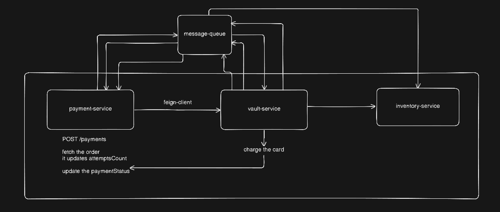
  <br>
  <em>Figure 19: Saga pattern illustrating distributed transaction coordination across microservices, with asynchronous messaging and failure handling to maintain consistency across service boundaries.</em>
</p>

A payment transaction spans multiple databases and external systems, so no single ACID transaction can cover the entire workflow. NexPay uses both **orchestrated and choreographed Sagas** to coordinate distributed operations and maintain consistency across microservices.

| **Saga Type** | **Location** | **Forward Steps** | **Compensation / Failure Handling** |
|---|---|---|---|
| Authorization Saga | `payment-service` | Record payment → Call payment gateway | Move payment to `FAILED` and emit `PAYMENT_AUTHORIZATION_COMPENSATED`. |
| Settlement Saga | `operations-service` | Pull unsettled payments → Transfer funds | Mark settlement as `FAILED`; payments remain `CAPTURED` for the next settlement run. |
| Webhook Saga | `operations-service` | Publish via outbox → Deliver to merchant | Retry delivery up to 7 attempts using exponential backoff, then move exhausted events to the Dead Letter Queue (DLQ). |

#### Key Benefits

- **Distributed Consistency:** Coordinates operations across independently managed databases and external systems.
- **Failure Handling:** Uses compensating actions or retry mechanisms when workflow steps fail.
- **Service Independence:** Allows microservices to manage their own transactions without requiring a global distributed transaction.
- **Fault Tolerance:** Supports recovery from partial failures while maintaining business-level consistency.

### API Key Rotation

<p align="center">
  
  <br>
  <em>Figure 20: Merchant API key rotation workflow illustrating credential replacement with an overlapping grace period, allowing merchants to transition to new API keys without immediate downtime.</em>
</p>

API key rotation allows merchants to securely replace compromised or expired API keys without disrupting active integrations. The entire flow is designed to prevent service interruption during the transition.

- **Security considerations:**

  - Disabled keys cannot be rotated — rotate() throws RuntimeException if the key is disabled.
  - The raw secret is returned only once in the rotation response; subsequent calls return only the key ID.
  - Secrets are never stored in plain text — only BCrypt hashes are persisted in PostgreSQL.
  - The grace period provides a safety net: if a merchant loses the new secret before updating all integrations, the old secret still works within the window.

## Tech Stack

You do not need to install the entire development stack to run NexPay. Prebuilt Docker images are available and can be deployed to a local Kubernetes Kind cluster. The technologies used in the project are listed below for reference.

- **Language:** Java 21
- **Backend Framework:** Spring Boot 4.1.1
- **Microservices:** Spring Cloud Gateway, Spring Cloud Config
- **ORM & Persistence:** Spring Data JPA, Hibernate
- **Database:** PostgreSQL
- **Caching & Distributed Coordination:** Redis
- **Messaging:** Apache Kafka
- **Security:** Spring Security, JWT, API Key Authentication, BCrypt
- **Object Mapping:** MapStruct
- **Distributed Scheduling:** ShedLock
- **Resilience & Fault Tolerance:** Resilience4j
- **Design Patterns:** Strategy, Saga, Transactional Outbox
- **API Documentation:** Springdoc OpenAPI / Swagger
- **Observability:** Prometheus, Grafana, Zipkin
- **Load Testing:** Apache JMeter
- **Containerization:** Docker, Jib
- **Orchestration:** Kubernetes (Kind)
- **Deployment Configuration:** Kustomize
- **Build Tool:** Maven
- **Development Tools:** IntelliJ IDEA, DBeaver, Postman

## Run Locally

NexPay runs in a local Kubernetes cluster using **Kind**, deploying all six application services along with PostgreSQL, Redis, Kafka, Zipkin, Prometheus, and Grafana.

> **Prerequisites:** Docker, `kind`, `kubectl`, and `openssl`.
>
> Allocate at least **8 GB of memory** to Docker and ensure that host port `8080` is available.

### 1. Clone the Repository

```bash
git clone https://github.com/hejazi-zarkawi/distributed-payment-gateway-microservices.git
```

### 2. Navigate to the Project Directory

```bash
cd distributed-payment-gateway-microservices
```

### 3. Start NexPay

```bash
./scripts/run-local.sh
```

The script automates the local deployment process:

- Creates the secrets file if it does not exist.
- Creates the Kind Kubernetes cluster.
- Applies the Kubernetes configurations.
- Deploys the application services and infrastructure components.
- Waits for the Kubernetes pods to become ready.

The first startup may take several minutes, primarily due to Docker image downloads and service initialization.

### 4. Access the API Gateway

Once the deployment is ready, access the centralized Swagger UI:

**Swagger UI:** [http://localhost:8080/swagger-ui.html](http://localhost:8080/swagger-ui.html)

### 5. Stop the Project

```bash
./scripts/run-local.sh down
```

### Script Commands

| **Command** | **Description** |
|---|---|
| `./scripts/run-local.sh` | Create the cluster and deploy NexPay (default command). |
| `./scripts/run-local.sh up` | Create the cluster and deploy all services. |
| `./scripts/run-local.sh down` | Delete the Kind cluster. |
| `./scripts/run-local.sh fresh` | Delete the existing cluster and redeploy from scratch. |
| `./scripts/run-local.sh status` | Display Kubernetes pods and services. |
| `./scripts/run-local.sh logs [pod]` | Follow logs for a specific pod or all pods. |
| `./scripts/run-local.sh pf` | Port-forward Grafana, Prometheus, Zipkin, and Kafka UI. |
| `./scripts/run-local.sh secrets` | Regenerate `k8s/k8s-secrets.env`. |
| `./scripts/run-local.sh up --timeout N` | Set the maximum pod readiness wait time in seconds (default: 600). |

### What the Script Does

The deployment script automates the following operations:

```bash
# Generate the secrets file if missing
cp k8s/k8s-secrets.env.example k8s/k8s-secrets.env

# Create the Kind cluster
kind create cluster --config k8s/kind-config.yaml

# Deploy Kubernetes resources
kubectl apply -k k8s/

# Wait for all pods to become ready
kubectl -n distributed-payment-gateway wait \
  --for=condition=Ready pod --all --timeout=600s
```

### Accessing Other Services

The API Gateway is exposed through host port `8080`. Other infrastructure services can be accessed using Kubernetes port-forwarding.

Run the following commands in separate terminals:

```bash
# Grafana
kubectl -n distributed-payment-gateway port-forward svc/grafana 3000:3000

# Prometheus
kubectl -n distributed-payment-gateway port-forward svc/prometheus 9090:9090

# Zipkin
kubectl -n distributed-payment-gateway port-forward svc/zipkin 9411:9411

# PostgreSQL
kubectl -n distributed-payment-gateway port-forward svc/postgres 5432:5432

# Redis
kubectl -n distributed-payment-gateway port-forward svc/redis 6379:6379

# Kafka
kubectl -n distributed-payment-gateway port-forward svc/kafka 9092:9092

# Config Server
kubectl -n distributed-payment-gateway port-forward svc/config-service 8888:8888
```

### Service Access URLs

| **Service** | **Local URL** |
|---|---|
| API Gateway / Swagger UI | [http://localhost:8080/swagger-ui.html](http://localhost:8080/swagger-ui.html) |
| Grafana | [http://localhost:3000](http://localhost:3000) |
| Prometheus | [http://localhost:9090](http://localhost:9090) |
| Zipkin | [http://localhost:9411](http://localhost:9411) |
| PostgreSQL | `localhost:5432` |
| Redis | `localhost:6379` |
| Kafka | `localhost:9092` |
| Config Server | [http://localhost:8888](http://localhost:8888) |

**Grafana credentials:** `admin` / the password configured through `GRAFANA_ADMIN_PASSWORD`.

### Quick Access to Observability Tools

To start port-forwarding the observability services together, run:

```bash
./scripts/run-local.sh pf
```

This provides access to Grafana, Prometheus, and Zipkin without manually starting each port-forward command.

### Deleting the Kubernetes Cluster

To remove the local deployment:

```bash
./scripts/run-local.sh down
```

To recreate the environment from scratch:

```bash
./scripts/run-local.sh fresh
```

> **Note:** The `fresh` command deletes the existing Kind cluster and its associated local Kubernetes data. Use it when you intentionally want a clean deployment.

## Load Testing

Performance testing was conducted using **Apache JMeter** to evaluate the performance, response times, throughput, and reliability of the Distributed Payment Gateway APIs deployed on Kubernetes (Kind).

### Test Scenarios

The load tests covered the following operations:

- **Create API Key** — Merchant API key generation.
- **Create Order** — Order creation API.
- **Init Payment** — Payment initialization API.
- **Reset API Keys File** — Test-data preparation and cleanup.

### Test Results

Two test runs were conducted to establish baseline performance and evaluate behavior under a significantly larger workload.

| Metric                | Initial Test | High-Volume Test |
| --------------------- | ------------ | ---------------- |
| Total Samples         | 526          | 40,201           |
| Failed Requests       | 0            | 0                |
| Error Rate            | 0.00%        | 0.00%            |
| Average Response Time | 25.39 ms     | 424.72 ms        |
| Median Response Time  | 14.00 ms     | 280.00 ms        |
| 90th Percentile (p90) | 50.30 ms     | 983.00 ms        |
| 95th Percentile (p95) | 83.30 ms     | 1,499.95 ms      |
| 99th Percentile (p99) | 109.19 ms    | 2,210.99 ms      |
| Maximum Response Time | 1,050 ms     | 3,908 ms         |
| Reported Throughput   | 27.63 req/s  | 308.58 req/s     |

<p align="center">
  
  <br>
  <em>Figure 21: JMeter transaction-level performance report covering 526 samples — 25 Create API Key requests, 250 Create Order requests, and 250 Initiate Payment requests — with response-time percentiles, throughput, and a 0% error rate.</em>
</p>

### High-Volume Test: API-Level Breakdown

| **API / Operation**              | **Samples** | **Avg. Response Time** | **p95**   | **p99**   | **Max** |
| --------------------------------- | ----------- | ---------------------- | --------- | --------- | ------- |
| Add API Key                       | 1           | 90.00 ms               | 90.00 ms  | 90.00 ms  | 90 ms   |
| Create API Key                    | 20          | 64.25 ms               | 99.20 ms  | 101.00 ms | 101 ms  |
| Create Order                      | 20,000      | 54.30 ms               | 142.00 ms | 290.00 ms | 429 ms  |
| Init Payment                      | 20,000      | 50.36 ms               | 99.00 ms  | 186.00 ms | 296 ms  |
| Order With Revoked Key (Expect 401)| 1           | 5.00 ms                | 5.00 ms   | 5.00 ms   | 5 ms    |
| Order With Rotated Secret         | 1           | 87.00 ms               | 87.00 ms  | 87.00 ms  | 87 ms   |
| Reset API Key (Rotate)            | 1           | 64.00 ms               | 64.00 ms  | 64.00 ms  | 64 ms   |
| Revoke API Key                    | 1           | 7.00 ms                | 7.00 ms   | 7.00 ms   | 7 ms    |


<p align="center">
  
  <br>
  <em>Figure 22: JMeter load testing report showing overall request statistics, response-time distribution, throughput, and a 0% error rate across 40,025 samples.</em>
</p>

<p align="center">
  
  <br>
  <em>Figure 23: JMeter performance summary displaying APDEX scores, tolerance and frustration thresholds, and request execution results with a 100% pass rate.</em>
</p>

### Key Observations

- **Zero reported failures:** All 40,025 recorded samples completed with a reported error rate of 0.00%.
- **High request volume:** Executed 20,000 Create Order requests and 20,000 Init Payment requests, alongside API key management and credential validation operations.
- **Throughput:** Achieved a reported aggregate throughput of 258.75 requests per second during the high-volume test.
- **Low overall latency:** Recorded an average response time of 52.34 ms, with an overall p95 of 162 ms and p99 of 281 ms.
- **Create Order performance:** Processed 20,000 requests with an average response time of 54.30 ms, p95 of 142 ms, and p99 of 290 ms.
- **Payment initialization performance:** Processed 20,000 requests with an average response time of 50.36 ms, p95 of 99 ms, and p99 of 186 ms.
- **API key lifecycle validation:** Tested API key creation, rotation, revocation, and requests using rotated credentials.
- **Revoked credential validation:** Verified that an order request using a revoked API key returned the expected HTTP 401 response without a JMeter assertion failure.
- **Application performance index:** Achieved an overall APDEX score of 1.000 using a 500 ms satisfaction threshold and a 1,500 ms frustration threshold.

### Tools and Technologies

- Apache JMeter — Load generation and performance reporting
- Spring Boot — Backend microservices
- Kubernetes (Kind) — Local container orchestration
- Prometheus and Grafana — Metrics collection and monitoring

### Test Artifacts

The JMeter test plan, execution results, and generated HTML reports are maintained in the project's load-testing directory. These artifacts provide reproducible test configurations and detailed performance measurements.

> **Note:** The reported results represent the observed performance of the local test environment. They do not establish production capacity or a maximum supported concurrent-user count. The two runs also differ in workload and reported performance, so their results should not be interpreted as a controlled benchmark comparison without matching concurrency, duration, and test configuration.
